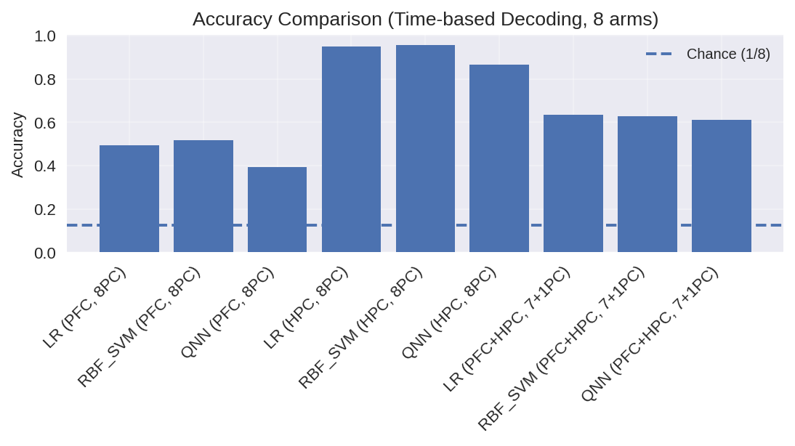

# Neural decoding: classical and quantum benchmarks

How much information about an animal's location can be decoded from neural
activity? This project compares four classical classifiers and a simulated
quantum neural network (QNN) on arm identification in an eight-arm maze, using
prefrontal cortex (PFC), hippocampus (HPC), and combined recordings.

**[Explore the notebook →](qnn.ipynb)** for worked examples, confusion matrices,
and model comparisons. The experiments cover three rewarded arms and all eight
arms, during arm visits and in the preceding time window.



*Saved eight-arm experiment: HPC features yield higher accuracy than PFC features
in this run. The dashed line marks uniform random guessing. See
[result interpretation](docs/methodology.md#saved-results) for the scope of these comparisons.*

The recordings are private. This repository provides the analysis code and 28
saved figures, which can be viewed without running the notebook. The broader
preprocessing pipeline and related analyses are in
[neural_data_analysis](https://github.com/enia-ardid/neural_data_analysis).

## Approach

Each event is represented by a matrix of neural activity over time. Normalization,
PCA and feature scaling are fitted within each training fold. The resulting
features feed logistic regression, linear and RBF support vector machines, random
forests, or a hybrid QNN with a classical output head.

The QNN uses five or eight qubits on PennyLane's `default.qubit` simulator and
trains through PyTorch. Results include accuracy, macro-F1 and held-out predictions.
The three-arm classical and quantum experiments use different cross-validation
protocols; the eight-arm experiments use trial groups for both model families.

[qnn.ipynb](qnn.ipynb) is the entry point for examples and plots.
[neural_decoding/](neural_decoding/) contains data loading, preprocessing, models,
evaluation and plotting. [Methods](docs/methodology.md) describes the input format,
model settings and interpretation of the saved results.

## Run locally

Use Python 3.12. From the repository root:

```bash
python3.12 -m venv .venv
source .venv/bin/activate
python -m pip install -r requirements.txt
python -m jupyterlab qnn.ipynb
```

On Windows, activate with `.venv\Scripts\activate`. The notebook opens with
training disabled, so it can be read and executed without access to the recordings.
Repeating the experiments requires the private data exports; full QNN training
can take substantially longer than the classical models on CPU.

With a trusted export in the ignored `data/` directory, the three-arm HPC baseline
can be run directly:

```python
from neural_decoding.data import load_events
from neural_decoding.baselines import evaluate_baselines

events = load_events("data/qnn_data.pkl", subset="rewarded")
metrics, predictions = evaluate_baselines(
    None, events.hpc, events.y, n_pcs_pfc=0, n_pcs_hpc=5,
    protocol="rewarded", random_state=42,
)
print(metrics["RBF_SVM"])
```

The notebook extends this example to QNN training and the full comparison across
brain areas. Its figures are stored in the notebook and remain available when
code outputs are cleared.

## Tests

```bash
python -m pip install -r requirements-dev.txt
python -m pytest -q
```

Tests cover data loading, training-fold preprocessing, trial separation, quantum
gradients, short benchmark runs, statistics and plots. They also check notebook
execution without private data and the integrity of all 28 saved images.
Synthetic inputs are used only for software tests; the experimental figures
come from the private recordings.
